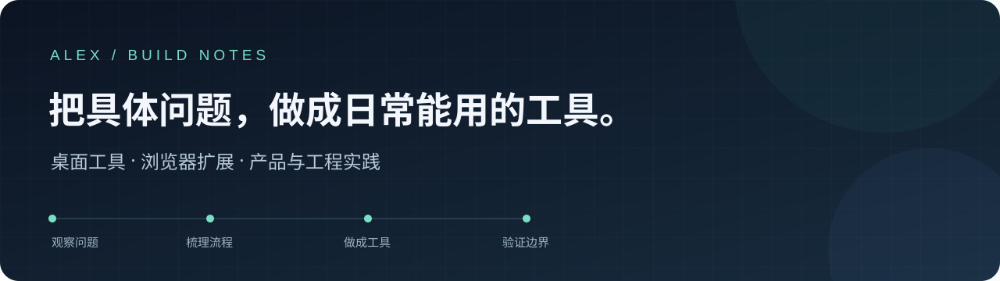

我关注重复操作和模糊流程里那些可以改进的地方，尝试把它们整理成可使用的工具。
这里主要放桌面工具、浏览器扩展，以及相应的产品取舍和工程实践。

实现过程中使用 AI 辅助，也持续核对程序行为、数据边界和交付结果。
项目的已验证内容、限制与后续事项，会尽量在各自的说明中写清楚。

## 公开工具

| 项目 | 解决的问题 | 从哪里开始 |
| --- | --- | --- |
| **[QuietMonitor](https://github.com/Alex-Wmz/QuietMonitor)** | 轻量桌面硬件监测与可选久坐提醒；把数据来源、未知状态和提醒行为分开处理 | [使用说明](https://github.com/Alex-Wmz/QuietMonitor#readme) · [下载](https://github.com/Alex-Wmz/QuietMonitor/releases) |
| **[HAR Exporter](https://github.com/Alex-Wmz/HAR-Exporter-Public)** | 录制网页网络请求，导出可检查的 HAR；处理正文缺失、保存失败与资源另存为 | [使用说明](https://github.com/Alex-Wmz/HAR-Exporter-Public#readme) · [下载](https://github.com/Alex-Wmz/HAR-Exporter-Public/releases) |

目前均以**预发布**方式维护。支持范围和真实设备待验项见仓库说明，源码测试通过不代表所有环境都已验收。

## 我在意的几件事

- **先把问题说清楚。** 功能从具体使用流程出发，保留范围和取舍。
- **让未知保持未知。** 数据缺失、失败和真实零值分别表达。
- **把交付也当作功能。** 安装、保存、更新和失败恢复需要一起考虑。
- **说明实现与来源。** 自己的工作、AI 辅助和上游组件分别写清。

## 使用与交流

两个项目的自有代码按 **PolyForm Noncommercial 1.0.0** 公开。
符合许可的非商业用途免费；商业使用须另行书面授权，可按具体情况商议许可费或分成。
它们属于**源码可见软件**，不称为 OSI 定义的开源。第三方组件与旧版本权利保持独立。

功能反馈或授权意向，可在对应项目的 Issues 中说明通用场景。
Issues 为公开区域，请勿放入邮箱、电话、凭据、真实 HAR 或其他个人资料。
安全漏洞使用各项目 Security 中的私密报告入口。
